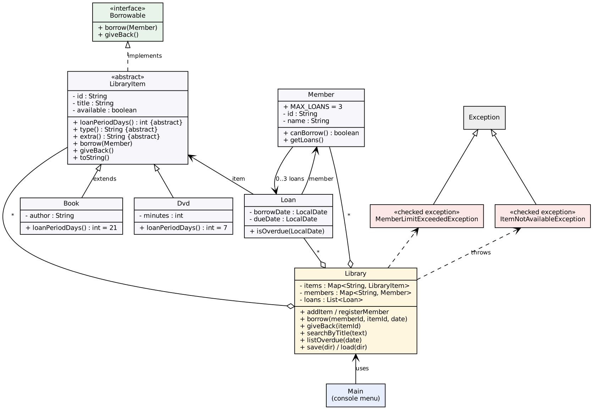

# 1. Objective

Build a console Library Management System that combines the main OOP ideas from Labs 1–10: classes and encapsulation, inheritance, abstraction, polymorphism, interfaces, custom exceptions, collections, streams, and CSV file persistence.

# 2. Design overview

| Class / interface | Responsibility | OOP idea shown |
|---|---|---|
| `LibraryItem` (abstract) | Holds id, title and availability; declares `loanPeriodDays()`, `type()`, `extra()` | Abstraction, encapsulation (private fields, validation) |
| `Book`, `Dvd` | Concrete items; Book = 21-day loan, DVD = 7-day loan | Inheritance, polymorphism |
| `Borrowable` (interface) | `borrow(Member)` and `giveBack()` | Programming to an interface |
| `Member` | Id, name and current loans; limit of 3 (`MAX_LOANS`); `getLoans()` returns an unmodifiable view | Encapsulation |
| `Loan` | Links an item to a member with borrow and due dates; `isOverdue(date)` | Composition |
| `ItemNotAvailableException`, `MemberLimitExceededException` | Checked, business-rule errors | Custom exceptions |
| `Library` | Owns `Map<String, LibraryItem>`, `Map<String, Member>` and the active loans; borrow, return, search, overdue, save, load | Single responsibility, collections, streams, file I/O |
| `Csv` | Reads and writes CSV lines, quoting fields that contain commas | No duplication |
| `Main` | Console menu only; no business logic | Separation of concerns |

# 3. How each requirement is met

1. **Book, Member, Loan** — private fields, constructors that validate (blank text, non-positive duration, null dates throw `IllegalArgumentException`), and `toString()`.
2. **Abstract `LibraryItem`** — `Book` and `Dvd` each override `loanPeriodDays()`.
3. **`Borrowable`** — implemented once in `LibraryItem`.
4. **Custom exceptions** — `Library.borrow` throws `MemberLimitExceededException` when a member already has 3 loans and `ItemNotAvailableException` when the item is out. Unknown ids throw `IllegalArgumentException`.
5. **Maps keyed by id** — `HashMap` for items and members. Duplicate ids are rejected.
6. **CSV persistence** — `save()` writes `items.csv`, `members.csv`, `loans.csv` on exit. `load()` reads them at start. A missing file means a first run, and a malformed line is skipped with a warning instead of crashing. Availability is rebuilt from `loans.csv`, so the two files cannot disagree.
7. **Menu** — add item, register member, borrow, return, list overdue, search by title, list all, save and exit.

# 4. Polymorphism in action

`Library.borrow` calls `item.borrow(member)` and `new Loan(item, member, date)`, which calls `item.loanPeriodDays()`. The library never checks whether the item is a Book or a DVD. A Book borrowed on 1 Jan is due 22 Jan, and a DVD is due 8 Jan. Adding a new item type (say `Magazine`) needs only a new subclass, which is the open/closed principle.

# 5. Collections and streams

`searchByTitle` filters (case-insensitive `contains`), sorts with `Comparator.comparing(LibraryItem::getTitle)` and returns `.toList()`. `listOverdue(today)` filters loans with `isOverdue` and sorts by due date. Both take the date or text as a parameter, which makes them easy to test.

# 6. Testing

`LibraryTests` is dependency-free (run `java LibraryTests`) and has 30 checks, all passing:

- loan periods (polymorphism)
- validation of every constructor
- successful borrow and the due date
- unavailable item, 4th-loan limit, and unknown member or item
- return and the slot being freed
- overdue boundary (not overdue on the due date, overdue the day after)
- search (case, order, no match)
- a save/load round trip that preserves counts, availability, a comma in a title, DVD type and due dates

Manual test: `sample_run_1.txt` and `sample_run_2.txt` show two separate program runs. The loan made in run 1 is still there in run 2 and can be returned.

# 7. Design decisions and limitations

- **Dates are passed in** (`LocalDate today`) rather than read inside `Library`, so overdue logic is testable without waiting for real time.
- **Checked exceptions** are used for expected business failures so callers must handle them.
- **No fines, renewals or reservations**, and `Library` is single-user and not thread-safe. These are natural extensions.
- **Design patterns from Lab 11** that fit well here: a *Factory* for creating items from CSV rows (currently an `if` in `load`), an *Observer* for overdue notifications, and a *Strategy* for per-member-type loan limits.

# 8. Conclusion

The system meets all seven requirements. Behaviour that varies (loan period) lives in subclasses, rules live in `Library`, and display lives in `Main`, so each class has one clear job.
